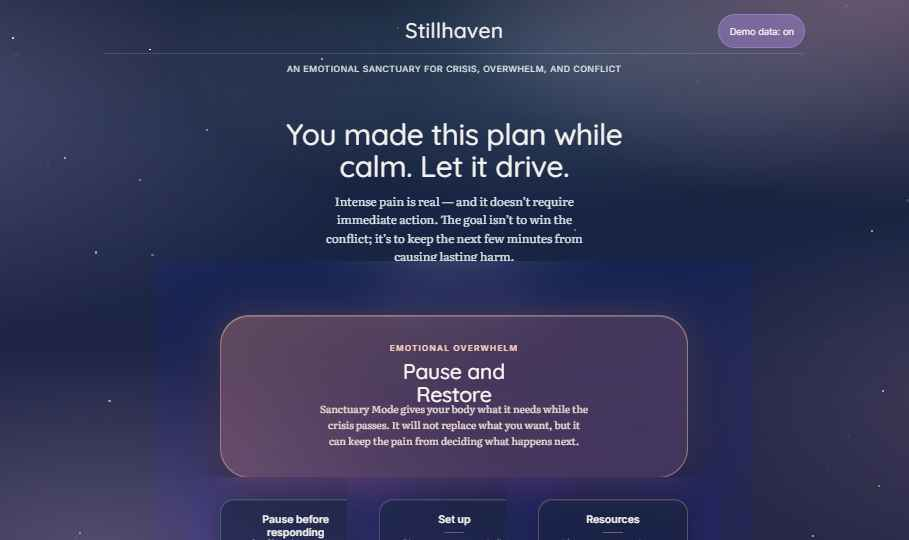
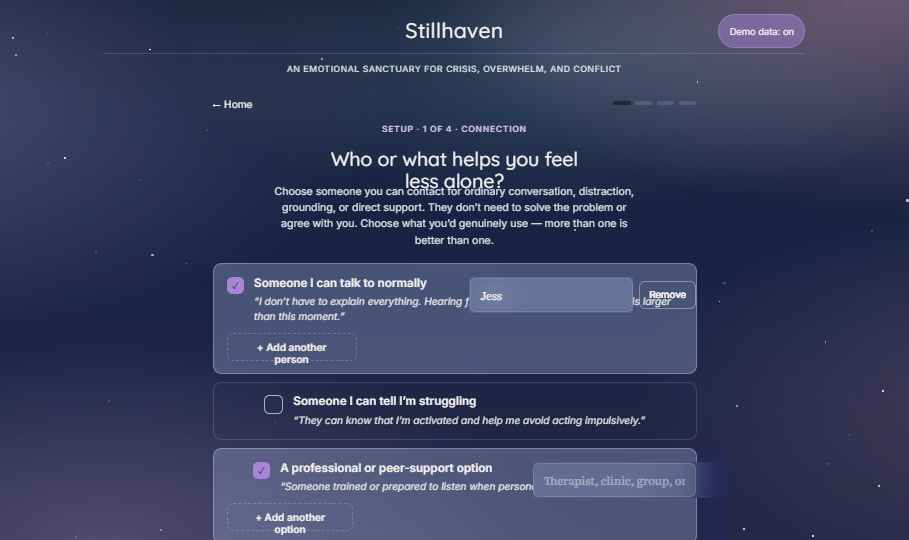
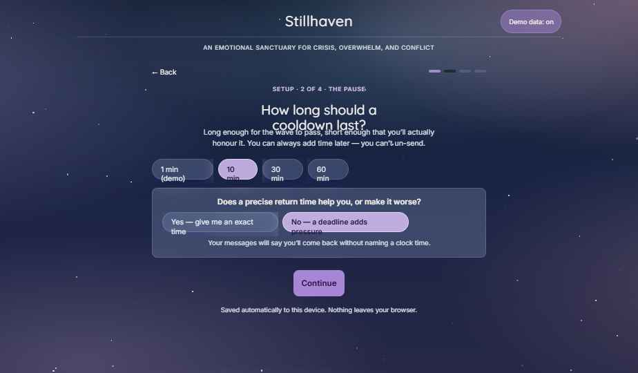
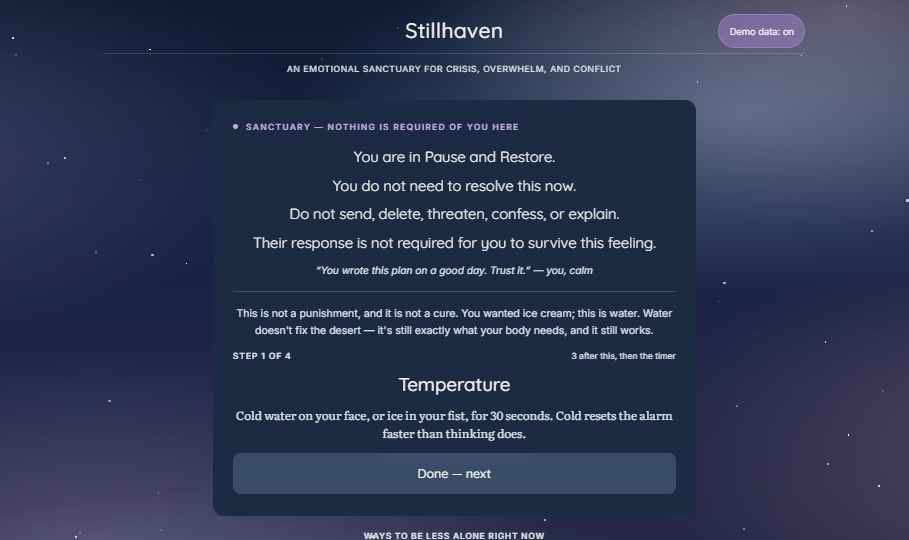
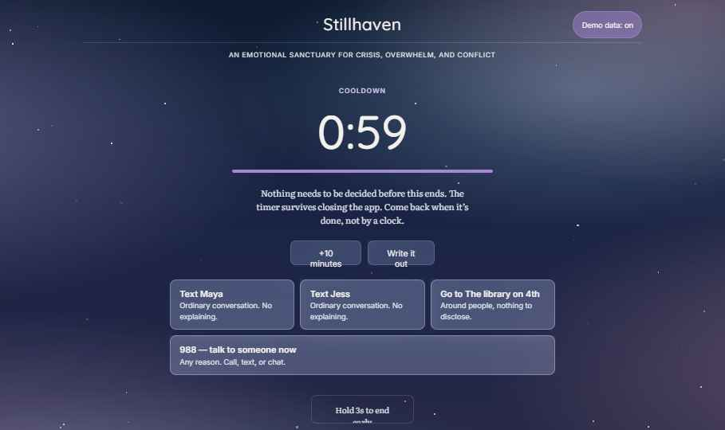

# Stillhaven

**A DBT-informed prototype for pausing before self-sabotage.**

> ⚠️ **Stillhaven is a design prototype, not a finished product.** It is not therapy, diagnosis, or emergency care. If you are in immediate danger or can't stay safe, call or text **988** (US) or your local emergency number.

**[Try the live prototype →](https://darianmarieisme.github.io/stillhaven/)**



## The idea

Most crisis tools only step in when something is clearly dangerous. But a lot of the damage people do to their own lives during emotional overwhelm isn't dangerous in that sense: sending the message, deleting everything, blocking someone, drinking, an impulse purchase, ending a relationship at 2 a.m. None of those are inherently unhealthy. They're just decisions that deserve a pause before the pain makes them.

Stillhaven is built on one premise: **the plan you made while calm should drive the next few minutes, not the pain.**

It doesn't label your choices as healthy or unhealthy, lock you out, or lecture you. When you're activated, it pauses you and hands back the guardrails you wrote for yourself on a good day. Then the choice is yours.

## How it works

**Set up (while calm).** You build your plan ahead of time: who or what you can reach for support, how long a cooldown should be, the urges you know you get (send, delete, numb, threaten...) and what you'll do instead of each one, and a closing line in your own words.

**Pause and Restore (emotional overwhelm).** One tap from the home screen opens Sanctuary mode. Nothing is required of you there. It shows "what you decided, while calm" as *when I want to X → I will instead Y*, offers practical regulation steps (temperature change, long exhales), ways to reach support, and a private place to write it out. Then it starts a cooldown timer.

**Pause before responding (conflict with someone).** Five short steps walk you from what happened, through what you feel and need, to a message you'd actually be okay sending. If the check partway through shows you're too dysregulated to send anything, it routes you into Sanctuary mode instead.

**Cooldown and reconnect.** A live timer you can extend, or end early by holding a button for three seconds. When it's done, Stillhaven helps you reconnect, or set a time to come back to it.

**Resources.** Crisis and support lines (988, 911, RAINN, the National Domestic Violence Hotline, 211), plus your own warmline if you added one.

## Design decisions

- **Agency over compliance.** The authority in the moment is calm-you, not the app. There's always a way out, including a deliberately small "exit and go home (not recommended)" link.
- **Edge cases from real crises.** What if you have no one to reach out to? What if the person you'd normally call is the person you're fighting with? Choosing a person as a support brings up a gentle note about "favorite person" dynamics, where the person you'd lean on may also be the one the conflict is with. Setup also points to warmlines and crisis resources for when no one is available.
- **Your words look like yours.** Anything you write yourself is set in a different typeface from the app's voice, so your own plan reads as yours, not as instructions.
- **Deliberately calming.** A slowly drifting twilight sky, and a tap on Pause and Restore that ripples outward like disturbed water into Sanctuary mode. Motion is fully disabled for users who prefer reduced motion.
- **Local-only by design.** No accounts, no network calls for your data, no analytics. Everything you write stays in your own browser's storage.

## Screens

| | |
|---|---|
|  |  |
|  |  |

All fifteen screens, in flow order, are in [`screens/`](screens/).

## Running it

Stillhaven is a single-file prototype. It loads its fonts and its React runtime from public CDNs, so you need an internet connection.

1. Clone or download this repository and keep the files together (`Stillhaven.dc.html`, `support.js`, `stars.svg`).
2. Serve the folder locally, for example:
   ```bash
   python -m http.server 8000
   ```
3. Open `http://localhost:8000/Stillhaven.dc.html`.

Opening the HTML file directly may work in some browsers, but a local server is more reliable. `Stillhaven Responsive Preview.dc.html` shows desktop and phone sizes side by side. `banner.js` adds the prototype notice at the top of every screen; remove its script tag from `Stillhaven.dc.html` to run without it.

Your setup is saved in your browser's local storage on that device only. Clearing site data erases it.

## Status

This is a working, clickable prototype of all seven screens. It is **not** a production app:

- It runs on a prototyping runtime (`support.js`) rather than a production framework.
- It hasn't been tested with real users, clinicians, or screen readers.
- The copy deals with self-harm urges, suicidal crisis, and abusive relationships and was written carefully, but it hasn't been reviewed by a mental health professional.

[`DESIGN_SPEC.md`](DESIGN_SPEC.md) is the full implementation spec (screens, interactions, motion, design tokens, and state model) for anyone who wants to rebuild it properly.

## Credits

Concept, design direction, and DBT framework by Darian Bruce. Built with Claude.

## License

[MIT](LICENSE)
